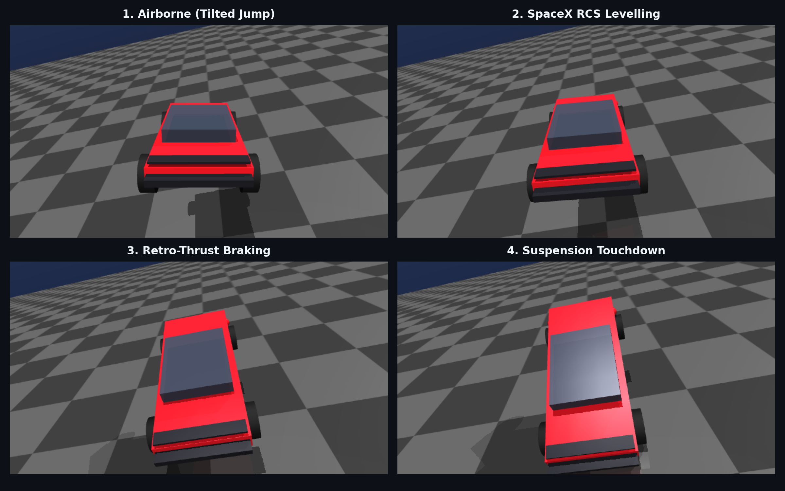

# 🚀 Tesla Roadster SpaceX Lateral Thruster Simulator

> **Tesla Roadster SpaceX 패키지 180° 반원 램프 점프 및 콜드가스 역추진 수평 착지 시뮬레이터**

Tesla Roadster 시연 동영상에서 영감을 받아 제작된 웹 기반 고성능 물리 시뮬레이터입니다.
90도 수직을 넘어 180도 완전 반원 궤도를 타고 거꾸로 뒤집힌 로드스터를 **SpaceX 콜드가스 스러스터**로 자세를 복원하고 수평을 유지하며 안전하게 터치다운시키는 게임 및 AI 시뮬레이션입니다.

---

## 🎮 주요 기능 (Features)

1. **완벽한 반원(Semi-Circle) 180° 메가 램프**:
   - 차체가 수직을 지나 180도 완전히 거꾸로 뒤집힌 상태(천장 매달림)로 공중에 진입합니다.
2. **3D 원근 롤(Roll) & 피치(Pitch) 물리 엔진**:
   - 2D Canvas 위에서 펼쳐지는 입체적인 차체 롤링과 쿼터뷰/사이드뷰 투영.
3. **SpaceX 듀얼 하부 노즐 & 측면 RCS 시스템**:
   - 앞머리 밑 분사, 뒷부분 밑 분사, 앞뒤 동시 분사로 피치 수평 평형 유지 및 소프트 터치다운.
4. **3가지 게임 모드**:
   - 🕹️ **수동 착지 (Manual)**: 직접 키보드와 온스크린 버튼으로 수동 착지 도전!
   - 🤖 **AI 오토파일럿 (Autopilot)**: Critical Damped PD 제어로 0.0° 완벽 수평 터치다운 시연.
   - ⚔️ **사람 vs AI 비교 (VS Mode)**: AI와 나의 컨트롤 실력을 나란히 비교!
5. **유저 맞춤형 슬로우 모션 (0.35x ~ 1.0x)**:
   - 긴장감 넘치는 공중 제어를 느긋하게 음미할 수 있는 타임 스케일 컨트롤.

---

## 🕹️ 조작 방법 (Controls)

| 구분 | 키보드 키 | 온스크린 버튼 | 동작 설명 |
| :--- | :--- | :--- | :--- |
| **🔄 180° 롤 회전** | `W` / `S` 또는 `▲` / `▼` | `180° 회전` | 180도 뒤집힌 차체를 정자세로 롤 회전 복원 |
| **🚀 앞머리 상승** | `A` 또는 `◀` | `앞머리 밑 분사` | 앞부분 밑 노즐 분사로 앞머리를 들어올려 수평 조절 |
| **🚀 뒷부분 상승** | `D` 또는 `▶` | `뒷부분 밑 분사` | 뒷부분 밑 노즐 분사로 뒷부분을 들어올려 수평 조절 |
| **⚡ 소프트 착지** | `A+D 동시` 또는 `SPACE` | `앞뒤 동시 분사` | 수평 유지 및 완충 감속 역추진 |
| **🔄 재도약** | `R` | `재도약 (R)` | 시뮬레이션 처음부터 다시 시작 |

---

## 🛠️ 기술 스택 (Tech Stack)

* **HTML5 Canvas** (순수 캔버스 2D 렌더링 & 파티클 연무 시스템)
* **Vanilla JavaScript** (ES6+ 수치해석 물리 적분기 & PD 자동제어 알고리즘)
* **Pure CSS3** (우주선 글래스모피즘 HUD & 반응형 콕핏 디자인)
* **Zero Dependencies**: 외부 라이브러리나 설치 없이 모든 브라우저에서 1초 만에 로딩!

---

## ☕ Support / 후원

프로젝트가 마음에 드셨다면 개발자에게 따뜻한 커피 한 잔을 선물해 주세요! ☕💛  
If you enjoyed this Tesla Roadster flight simulator, feel free to buy me a coffee!

---

## 📄 License
MIT License
